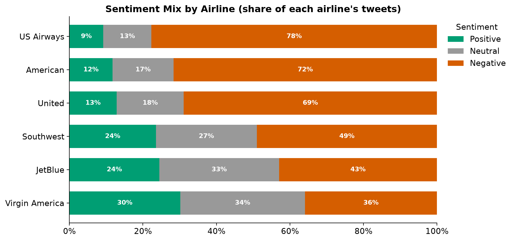
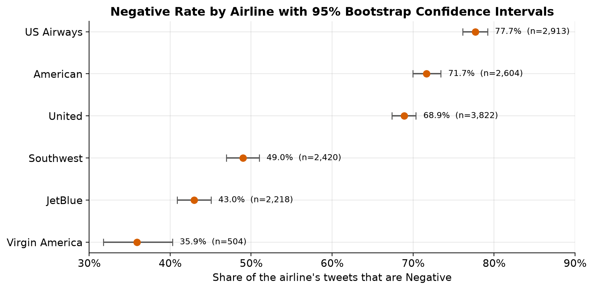
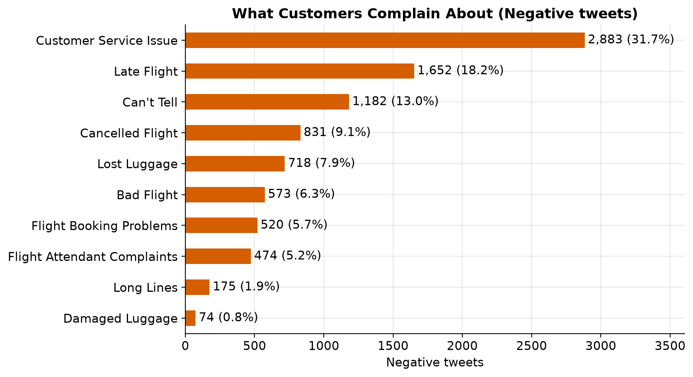
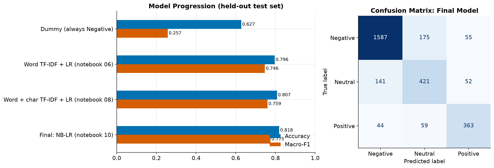
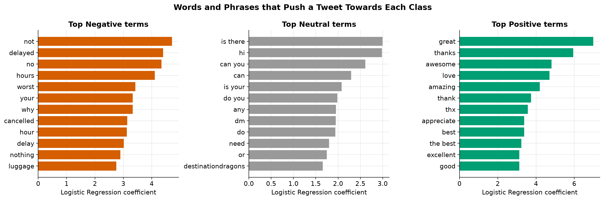

# Airline Sentiment Analysis: What 14,000 Tweets Reveal About US Airlines

[](https://github.com/OWNER/airline-sentiment-analysis/actions/workflows/tests.yml)


An end-to-end data science project on customer feedback about six US airlines. It covers data auditing and cleaning, exploratory and statistical analysis, business recommendations, and a classical NLP model that predicts tweet sentiment.

**Headline results**
- **62.7%** of the tweets are negative, and airlines split into two clear groups: Net Sentiment Score from **−5.8** (Virgin America) to **−68.5** (US Airways).
- **Customer service**, not delays, is the top complaint, at **31.7%** of complaints and #1 at 5 of 6 airlines.
- Data validation found that the source labelled **JetBlue** tweets as "Delta". This was corrected with a documented, test-covered rule.
- The final text model (NB-weighted Logistic Regression on word + character TF-IDF) reaches **81.8% accuracy / 0.775 macro-F1** on a held-out test set (**82.0% ± 0.5 / 0.774 ± 0.007** across 10 random splits with hyperparameters re-tuned inside each split).

---

## Contents
[Business problem](#business-problem) · [Dataset](#dataset) · [Repository structure](#repository-structure) · [Workflow](#workflow) · [Key findings](#key-findings) · [Machine learning](#machine-learning) · [Getting started](#getting-started) · [Limitations](#limitations-and-future-work) · [Origin](#project-origin-and-attribution)

## Business problem

Airlines receive a constant stream of public feedback on social media. A customer-experience team needs to know:

1. How customers feel about each airline, measured fairly despite very different tweet volumes.
2. Which complaint categories dominate, and where each airline's weak spot is.
3. Which complaints get amplified.
4. Whether incoming tweets can be triaged automatically by sentiment.

## Dataset

| | |
|---|---|
| Source | [Twitter US Airline Sentiment](https://www.kaggle.com/datasets/crowdflower/twitter-airline-sentiment) on Kaggle, originally released by Figure Eight (CrowdFlower) in its *Data for Everyone* library |
| Size | 14,640 tweets × 15 columns (raw), 14,481 × 23 after cleaning |
| Period | 16–24 February 2015 |
| Airlines | American, JetBlue (labelled "Delta" in the source), Southwest, United, US Airways, Virgin America |
| Labels | Sentiment by human contributors: **Negative 9,082 · Neutral 3,067 · Positive 2,332** (cleaned), plus a complaint category for negative tweets |

**The data is not included in this repository.** Download `Tweets.csv` from the Kaggle page above and place it in `data/raw/`. The Kaggle page lists the dataset under a Creative Commons BY-NC-SA 4.0 licence. Tweet content is also subject to X/Twitter's terms, so please check both before redistributing the data. See [`data/README.md`](data/README.md) for the processed column dictionary.

## Repository structure

```
airline-sentiment-analysis/
├── README.md
├── requirements.txt / requirements-dev.txt
├── pytest.ini
├── .github/workflows/tests.yml   # unit tests on every push / PR
├── data/                         # not tracked: raw/Tweets.csv, processed/cleaned_tweets.csv
├── docs/methodology.md           # decisions, protocol, limitations
├── images/                       # charts exported by the notebooks
├── notebooks/
│   ├── 01_data_understanding.ipynb
│   ├── 02_data_cleaning.ipynb     # writes data/processed/cleaned_tweets.csv
│   ├── 03_exploratory_analysis.ipynb
│   ├── 04_business_insights.ipynb
│   ├── 05_statistical_analysis.ipynb
│   ├── 06_ml_baselines.ipynb
│   ├── 07_model_tuning.ipynb
│   ├── 08_advanced_nlp.ipynb
│   ├── 09_metadata_analysis.ipynb
│   └── 10_final_model.ipynb
├── src/
│   ├── config.py                 # paths (work from any directory), seed, label order
│   ├── data.py                   # loading, airline-label correction, shared split
│   ├── preprocessing.py          # clean_tweet, clean_tweet_plus, username masking
│   ├── features.py               # TF-IDF builders
│   ├── modeling.py               # pipelines, NBLogisticRegression, save/load
│   ├── evaluation.py             # metrics, per-class report, leakage-free repeated splits
│   ├── plotting.py               # colour-blind-safe palette and figure export
│   ├── train.py                  # python -m src.train
│   └── predict.py                # python -m src.predict "..."
└── tests/                        # 52 unit tests (synthetic data, no download needed)
```

## Workflow

| Step | Notebook | What happens |
|---|---|---|
| Audit | 01 | Missing values, duplicates, conflicting labels, airline-label check, timestamp check |
| Clean | 02 | Drop sparse/personal columns, resolve duplicates by label confidence, fill structural gaps, **correct Delta→JetBlue**, engineer date and sentiment features, assert 10+ validation rules |
| Explore | 03 | Sentiment mix, Net Sentiment Score, complaints, retweets, time patterns and their collection artefacts |
| Business Q&A | 04 | 17 questions answered by count *and* rate; recommendations |
| Statistics | 05 | Chi-square + Cramér's V, bootstrap CIs, Kruskal–Wallis |
| Baselines | 06 | Dummy, Naive Bayes, TF-IDF + Logistic Regression |
| Tuning | 07 | Grid search, top terms per class, error analysis vs annotator agreement |
| Advanced NLP | 08 | Word + character TF-IDF, leakage-free stability, handle ablation, complaint routing |
| Metadata | 09 | Can non-text signals predict complaints? Comparison with the text model |
| Final model | 10 | Sentiment-aware preprocessing, NB-weighted LR, bug-fix ablation, stability |

The full rationale is in [docs/methodology.md](docs/methodology.md).

## Key findings

**Two groups of airlines.** Virgin America, JetBlue and Southwest have Negative shares below 50%; United, American and US Airways are at 69–78%.



**The split is statistically robust.** The chi-square test gives p ≈ 10⁻²⁴³ with Cramér's V = 0.20 (a small-to-moderate effect). The bootstrap intervals of the two groups do not overlap. Only United vs American cannot be ranked with confidence, and Virgin America's interval is the widest because it has only 504 tweets.



**Customer service dominates complaints.** Customer Service Issue (31.7%) and Late Flight (18.2%) make up half of all complaints. 13% are "Can't Tell", which cannot be routed to a team. Each airline has a distinct operational weak spot, measured per 100 tweets:

| Complaint | Most complaints (count) | Highest rate per 100 tweets |
|---|---|---|
| Customer Service Issue | US Airways (811) | American (28.5) |
| Late Flight | United (525) | US Airways (15.6) |
| Cancelled Flight | American (230) | American (8.8) |
| Lost Luggage | United (269) | United (7.0) |



**Other findings**
- Negative tweets are about twice as likely to be retweeted (6.6% vs 3.2% for Positive). The difference is significant, but its effect size is tiny (ε² = 0.005).
- The 22–23 Feb volume spike is mostly a **collection artefact**: 99.85% of American Airlines' tweets fall on 22–24 Feb. Excluding American, the complaint mix is stable (no category moves more than 2.2 points).
- Metadata alone (airline, hour, retweets, profile fields) predicts complaints only weakly (ROC-AUC 0.69, mostly from `airline`). The text reaches **0.93** on the same tweets.

**Recommendations** (to be validated with operational data): prioritise social-care recovery at American and US Airways; target each airline's specific driver (cancellations, baggage, delays); triage Negative tweets that start gaining retweets; report Net Sentiment Score together with volume; fix the "Can't Tell" taxonomy; and validate airline labels and collection coverage before any trend analysis.

## Machine learning

**Task:** predict the 3-class sentiment label from tweet text.

**Protocol**
- One stratified 80/20 split (`random_state=42`, 11,584 / 2,897 tweets) is shared by all models.
- Cleaning, vectorisers and classifiers are fitted inside scikit-learn pipelines on training data only.
- Model selection uses cross-validation on the training split. The test set is scored once.
- **Macro-F1** is the primary metric, because a majority-class model already reaches 63% accuracy.

**Held-out test results**

| Model | Notebook | Accuracy | Macro-F1 | Weighted-F1 |
|---|---|---|---|---|
| Majority class (Dummy) | 06 | 0.627 | 0.257 | 0.484 |
| Multinomial Naive Bayes | 06 | 0.753 | 0.629 | 0.720 |
| Word TF-IDF + Logistic Regression | 06 | 0.796 | 0.746 | 0.798 |
| Tuned word TF-IDF + LR | 07 | 0.799 | 0.748 | 0.801 |
| Word + char TF-IDF + LR | 08 | 0.807 | 0.759 | 0.809 |
| **Final: sentiment-aware cleaning + word/char TF-IDF + NB-weighted LR** | 10 | **0.818** | **0.775** | **0.820** |

Per-class (final model) precision / recall / F1: Negative 0.896 / 0.873 / 0.884, Neutral 0.643 / 0.686 / 0.664, Positive 0.772 / 0.779 / 0.776. Neutral is hardest; most errors fall on the Negative↔Neutral boundary, where annotators themselves disagree most.

**Robustness (not single-split luck).** Both the notebook 08 model and the final model were re-evaluated on 10 random 80/20 splits. For each split, `C` was re-selected by cross-validation *inside that split's training data*, so no test tweet influences tuning. Final model: accuracy 0.820 ± 0.005, macro-F1 0.774 ± 0.007. Notebook 08 model: 0.808 ± 0.005 and 0.762 ± 0.008. The final model wins on **10 of 10** paired splits (mean +1.2 accuracy points). The cross-validated gap between NB-LR and a Linear SVM on the same features is within one standard deviation, so the classifier choice itself is not decisive.

*Bug-fix note:* fixing the URL/emoticon preprocessing bug changed cross-validated macro-F1 by less than 0.001. It was a correctness fix, not a source of accuracy.



**What makes the final model work**
- *Preprocessing* (`clean_tweet_plus`): emoticon and emoji tokens, elongation shortening, and negation-scope marking (`not happy` → `not happy_neg`) that handles curly apostrophes and forms like `dont`.
- *Features:* punctuation tokens (`?` signals Neutral questions), full vocabulary, character 2–6-grams.
- *Classifier:* NB-weighted Logistic Regression, a variant of NBSVM (Wang & Manning, 2012). Its differences from the original are documented in [methodology](docs/methodology.md#nb-weighted-logistic-regression-vs-nbsvm).

**Interpretability.** The tuned word model's coefficients match intuition: negations and disruption words drive Negative, thanks and praise drive Positive, and questions drive Neutral. Accuracy is 88% on tweets where all annotators agreed but only 26% on the least certain labels, so label noise caps what any model can reach.



## Getting started

```bash
git clone https://github.com/OWNER/airline-sentiment-analysis.git
cd airline-sentiment-analysis
python -m venv .venv
source .venv/bin/activate          # Windows: .venv\Scripts\activate
pip install -r requirements-dev.txt
```

**1. Get the data:** download `Tweets.csv` from [Kaggle](https://www.kaggle.com/datasets/crowdflower/twitter-airline-sentiment) into `data/raw/`.

**2. Reproduce the analysis:** run the notebooks in order. Notebook 02 must run before the others, because it writes `data/processed/cleaned_tweets.csv`. Notebooks find the project root themselves, so they work from any directory.

```bash
jupyter lab                         # interactive
jupyter nbconvert --to notebook --execute --inplace notebooks/*.ipynb   # headless, ~25 min on 12 cores
```

Running the notebooks regenerates `data/processed/cleaned_tweets.csv` and the charts in `images/`.

**3. Train and save the final model** (about 10 s; writes `models/sentiment_model.joblib`, which is git-ignored):

```bash
python -m src.train                 # train on 80%, print test metrics, save
python -m src.train --all-data      # same evaluation, then refit on all rows before saving
```

**4. Predict:**

```bash
python -m src.predict "@united my flight got cancelled and nobody will help" "@JetBlue thanks for the amazing crew!"
```
```
                                                text predicted  Negative  Neutral  Positive
@united my flight got cancelled and nobody will help  Negative     0.937    0.054     0.009
               @JetBlue thanks for the amazing crew!  Positive     0.000    0.018     0.982
```

**5. Run the tests:** `pytest` (52 tests covering preprocessing edge cases, the label-correction rule, the pipelines, NB-LR and model save/load).

## Limitations and future work

- **One week of 2015 data** with uneven airline coverage, so there are no trend or seasonality claims.
- **Label noise:** many errors are on tweets whose annotators disagreed.
- **Bag-of-words models** cannot read sarcasm, and their probabilities are not calibrated.
- **Observational analysis:** associations between airline and sentiment are not causal, and Twitter over-represents complaints.
- **Future work:** fine-tune a transformer (e.g. RoBERTa) and compare it on the same split and metrics; calibrate probabilities; improve the "Can't Tell" complaint taxonomy; evaluate on newer data.

## Project origin and attribution

This project was originally developed as an academic group project and was later refactored, corrected and extended for portfolio presentation. Dataset credit: Figure Eight (CrowdFlower) *Data for Everyone* / Kaggle. NBSVM reference: S. Wang and C. Manning, "Baselines and Bigrams: Simple, Good Sentiment and Topic Classification", ACL 2012.
